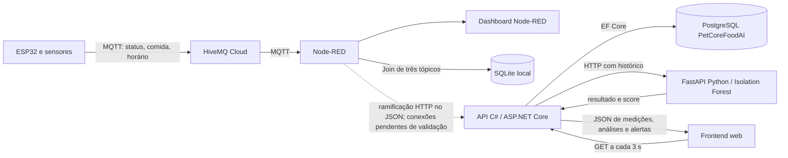
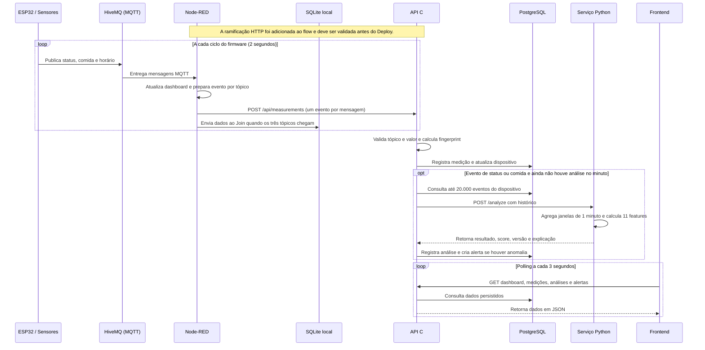

# PetCore Food AI

## 1. Sobre o projeto

O PetCore propõe integrar tecnologia, monitoramento e automação para apoiar o acompanhamento da rotina dos animais. O **PetCore Food AI** é um protótipo independente voltado à tigela inteligente: usa sensores conectados a um ESP32 para registrar presença do pet perto do comedouro, presença ou ausência de alimento e horário das leituras.

Os eventos podem ser consultados em um dashboard web e analisados ao longo do tempo por um modelo de Machine Learning. A análise procura padrões estatisticamente diferentes do histórico observado para fornecer informação adicional aos responsáveis pelo animal. Ela não substitui acompanhamento veterinário.

## 2. Problema e justificativa

Uma leitura isolada informa somente o estado detectado naquele instante. Sem histórico, é difícil perceber se a presença do animal ou a disponibilidade de comida mudou em relação à rotina observada. O projeto coleta eventos repetidos para formar uma série temporal e permite acompanhar essas mudanças.

A tigela pode sinalizar presença ou ausência do pet e de comida. Os sensores ultrassônicos não pesam a ração e não medem quanto o animal comeu. Portanto, disponibilidade de comida não equivale a consumo real.

## 3. Tecnologias utilizadas

| Responsabilidade | Tecnologia | Uso no projeto |
|---|---|---|
| IoT | ESP32 e sensores ultrassônicos | Mede distância e converte os limiares em estados de presença do pet e de comida. |
| Comunicação | MQTT e HiveMQ Cloud | Transporta os tópicos publicados pelo ESP32 até o Node-RED. |
| Integração | Node-RED | Recebe os tópicos, atualiza o dashboard existente e agrupa estados para o histórico SQLite; o JSON também inclui uma ramificação HTTP para a API, ainda pendente de validação dos wires. |
| Backend | C# e ASP.NET Core Minimal APIs | Valida e persiste eventos, consulta o PostgreSQL, chama o serviço ML e disponibiliza endpoints para o frontend. |
| Persistência principal | PostgreSQL e Entity Framework Core | Guarda dispositivos, medições, modelos, análises e alertas. A API aplica migrations na inicialização. |
| Análise | Python, FastAPI, Scikit-learn e NumPy | Agrupa eventos em janelas de um minuto, calcula características e executa Isolation Forest. Joblib grava e carrega o modelo. |
| Frontend | HTML, CSS e JavaScript | Apresenta indicadores, estados dos sensores, histórico, análises e alertas. Chart.js gera o gráfico; DM Sans e Manrope são carregadas do Google Fonts. O monograma textual P é provisório; não há asset oficial de logo nesta pasta. |
| Infraestrutura | Docker e Docker Compose | Inicia PostgreSQL, API, serviço ML e servidor estático Nginx. Node-RED permanece fora do Compose por usar SQLite local. |

## 4. Arquitetura geral do sistema



O SQLite continua atendendo o fluxo e o histórico do Node-RED. O PostgreSQL é a persistência da aplicação independente PetCore Food AI; eles têm finalidades separadas. A comunicação API–ML ocorre por HTTP dentro da rede Docker (`api` → `ml`); o navegador não chama o serviço ML diretamente.

> **Situação do flow:** o arquivo `node-red/flow.json` contém a ramificação HTTP adicionada aos nós MQTT e preserva os nós do dashboard e do SQLite. Na revisão, os campos `wires` dos dois nós novos (normalizador e HTTP Request) aparecem como listas simples de strings; os nós originais usam listas de listas, que é o formato do restante da exportação Node-RED. Por isso, a integração HTTP ainda precisa ser importada/reconectada e validada no Node-RED antes de ser considerada operacional. Essa tarefa atualiza somente a documentação; não modifica o flow.

## 5. Pipeline de dados



### Etapa 1 — Coleta

A versão de dois sensores em `Challenge_2ano/sprint1e2/Iot/Challenger_Iot1/Sensores.c++` usa um sensor ultrassônico para presença do pet (TRIG 5, ECHO 18; distância menor que 120 cm significa `PET DETECTADO`) e outro sensor para comida (TRIG 4, ECHO 16; distância maior que 10 cm significa `COM COMIDA`). Em cada ciclo, também publica o valor local `HH:mm:ss`; se o relógio falhar, publica `SEM HORA`.

Os tópicos e valores usados são:

| Tópico | Valores conhecidos |
|---|---|
| `petcore/status` | `PET DETECTADO`, `SEM PRESENCA` |
| `petcore/comida` | `COM COMIDA`, `SEM COMIDA` |
| `petcore/horario` | `HH:mm:ss`, `SEM HORA` |

O firmware publica os três tópicos e aguarda aproximadamente dois segundos antes do ciclo seguinte. O projeto `IaPetCore` não contém o firmware: o caminho acima identifica o arquivo de referência externo analisado. Há também uma cópia `Iot_sprint1/Sensores.c++` que publica apenas presença e horário; com essa versão, o estado de comida não chega ao sistema.

### Etapa 2 — MQTT / HiveMQ

O ESP32 publica os valores no HiveMQ Cloud usando MQTT na porta TLS 8883. O broker entrega as mensagens aos nós `mqtt in` do Node-RED. As credenciais são configuradas localmente no broker e no firmware; não devem ser incluídas no README ou no JSON de exportação.

### Etapa 3 — Node-RED, dashboard e SQLite

O JSON de referência inclui o dashboard Node-RED para os três estados e um banco SQLite local em `C:\Users\ADM\.node-red\challenger.db`. O Join está configurado para esperar três tópicos, aguardar até cinco segundos e descartar uma junção incompleta antes do `INSERT`; o fluxo de API, por outro lado, deve encaminhar cada mensagem recebida individualmente.

Após corrigir e validar a ramificação, ela transforma cada mensagem em JSON com `deviceId`, `topic`, `value`, `eventTime`, `eventId` e `data`, e usa `POST /api/measurements`. O endereço padrão é `http://localhost:5080/api/measurements`; `PETCORE_API_URL` e `PETCORE_DEVICE_ID` podem ser definidos no processo Node-RED. Como detalhado na situação do flow acima, o arquivo precisa ser validado e suas conexões corrigidas no editor Node-RED antes do Deploy.

O SQLite é local ao Node-RED. O Compose não inicia nem migra esse banco.

### Etapa 4 — API e PostgreSQL

A API é uma Minimal API em `backend/PetCore.Api/Program.cs`. A rota `POST /api/measurements` aceita um tópico por requisição, valida os estados reconhecidos, registra dispositivo, tópico, valor, unidade, horário recebido, origem e dados originais JSONB. O fingerprint impede a gravação repetida do mesmo `deviceId` + tópico + `eventId`; se o `eventId` não for enviado, usa tópico, valor e `eventTime` como base.

O banco `PetCoreFoodAI` é independente do banco do PetCore principal. O EF Core aplica migrations na inicialização. Se o serviço ML não responder em até três segundos, a medição já persistida continua armazenada e a rota ainda pode concluir a ingestão.

### Etapa 5 — Preparação para a IA

O backend envia análise apenas ao receber evento de `petcore/status` ou `petcore/comida`; o tópico de horário é contexto, não dispara uma análise por si só. Para limitar duplicidade de leituras, o backend persiste no máximo uma análise por dispositivo em cada minuto quando o ML responde; se o ML estiver indisponível, novas mensagens podem tentar novamente. Quando analisa, consulta até 20.000 eventos anteriores do dispositivo, incluindo status, comida e horário.

O Python ordena os eventos por horário e os reúne em minutos ocupados. Repete-se o último estado conhecido de pet e comida até que haja uma alteração; várias leituras iguais ocorridas nos mesmos 60 segundos não viram amostras independentes. Para cada janela com ambos os estados conhecidos, o código calcula 11 características:

1. Estado de presença do pet e estado de presença de comida, codificados como 0/1.
2. Diferença de cada estado em relação à janela anterior.
3. Média dos estados de pet e de comida na janela atual e até 14 janelas anteriores.
4. Minutos desde a última mudança de cada estado.
5. Intervalo em minutos desde a janela ocupada anterior, limitado a 1.440.
6. Seno e cosseno do horário do dia, usando o tópico local `petcore/horario` quando válido.

O serviço requer pelo menos 30 janelas válidas com ambos os estados antes de classificar. Isso corresponde a aproximadamente 30 minutos de histórico contínuo com os sensores presentes; lacunas podem alongar o período.

### Etapa 6 — Análise e retorno

Com histórico insuficiente, o serviço devolve `coletando`, sem score e sem afirmar que existe um modelo treinado. Com dados suficientes, usa `IsolationForest` e devolve `normal` ou `anomalia`, score numérico de `decision_function`, versão, parâmetros e explicação. O backend registra a análise; quando o resultado é `anomalia`, também cria um alerta associado à medição e à análise.

### Etapa 7 — Apresentação

O frontend consulta a API a cada três segundos. Mostra o estado mais recente do pet e da comida, indicador de conexão, atividade recente do dispositivo, gráfico dos dois estados, medições, resultado mais recente da IA e alertas. A interface não popula a tela com leituras fictícias quando o banco está vazio. O dashboard Node-RED continua sendo outra apresentação do mesmo fluxo MQTT e do histórico SQLite local.

## 6. Inteligência Artificial no PetCore

Guardar e exibir leituras é útil, mas deixa para o responsável comparar visualmente muitas observações de dois em dois segundos. A análise temporal procura resumir sequências e destacar combinações ou durações de estados que se afastem do histórico registrado.

O Isolation Forest foi escolhido porque a proposta é detectar observações raras sem exigir que cada padrão anômalo seja rotulado previamente. O modelo aprende a distribuição das características de presença, comida, transições e horário; um desvio pode orientar uma conferência do histórico ou da tigela. Assim, o Machine Learning atende ao objetivo de extrair sinais de uma série temporal de sensores, em vez de apenas acrescentar uma tecnologia sem função no fluxo.

O PetCore usa **Machine Learning para detecção de anomalias**, não IA generativa. Não gera texto ou imagem, não conversa com o usuário e não diagnostica doença. Um resultado `anomalia` descreve um desvio estatístico no padrão observado e pode ter causas variadas, inclusive ruído de sensor, mudança no ambiente ou uma alteração real de rotina.

## 7. Funcionamento do modelo

- **Biblioteca e serviço:** Python, FastAPI, NumPy e Scikit-learn.
- **Algoritmo:** `sklearn.ensemble.IsolationForest`.
- **Entrada:** snapshots de um minuto que possuem estado conhecido de pet e comida; horário local é incluído quando disponível.
- **Parâmetros configurados:** `n_estimators=100`, `contamination=0.05` e `random_state=42`.
- **Mínimo:** 30 janelas com os dois estados. O endpoint de treinamento manual devolve `coletando_dados` antes desse mínimo.
- **Treinamento:** na primeira análise com dados suficientes o serviço treina automaticamente se ainda não houver modelo compatível. `POST /api/ml/train` também permite ajustar o modelo ao histórico disponível. A versão do serviço/modelo é `2.0.0`.
- **Persistência:** `joblib` grava o estimador no volume `mlmodel` do Compose, em `/data/model.joblib`.
- **Resultado:** `predict` classifica como normal (`1`) ou anomalia (`-1`); `decision_function` fornece o score numérico retornado pela API. Esse valor não é porcentagem de confiança.

Não há no repositório resultado de avaliação com conjunto rotulado, taxa de precisão, recall ou validação clínica. O parâmetro `contamination` é uma configuração do algoritmo, não uma métrica de qualidade medida no projeto.

## 8. Estrutura do projeto

```text
IaPetCore/
├── backend/PetCore.Api/
│   ├── Data/                 # DbContext e fábrica de design-time
│   ├── Migrations/           # Migration inicial do EF Core
│   ├── Models/               # Dispositivos, medições, IA, análises e alertas
│   ├── Program.cs            # Minimal APIs e integração C#–Python
│   └── Dockerfile
├── frontend/                 # HTML, CSS e JavaScript do dashboard web
├── ml/                       # FastAPI, Isolation Forest e dependências Python
├── node-red/flow.json        # Flow MQTT + dashboard/SQLite + ramificação HTTP
├── scripts/                  # start.ps1 e stop.ps1
├── docker-compose.yml
├── .env.example
└── README.md
```

O firmware permanece no projeto de IoT externo indicado na seção do pipeline.

## 9. Como executar o projeto

### Pré-requisitos

- Docker Desktop com Docker Compose ativo.
- Node-RED já instalado para reutilizar o flow, o dashboard e o SQLite local.
- Acesso ao HiveMQ Cloud e credenciais de MQTT configuradas localmente.
- Para execução sem Docker: SDK .NET 8, Python 3.11 e PostgreSQL compatível com Npgsql.

### Subir API, PostgreSQL, ML e frontend

Na pasta `IaPetCore`, crie o arquivo local `.env`, edite a senha e rode o script. O script copia o exemplo e encerra na primeira execução se `.env` não existir; depois de editar, execute-o novamente.

```powershell
Copy-Item .env.example .env
notepad .env
.\scripts\start.ps1
```

O único valor obrigatório no `.env.example` é `POSTGRES_PASSWORD`; use uma senha local própria. `.env` está no `.gitignore`. O Compose conecta a API ao PostgreSQL pelo hostname de serviço `db` e ao Python por `http://ml:8000`; o front é servido pelo Nginx. Para encerrar os containers sem apagar os volumes, execute:

```powershell
.\scripts\stop.ps1
```

| Serviço | Endereço no host |
|---|---|
| Frontend PetCore Food AI | `http://localhost:8080` |
| API C# | `http://localhost:5080` |
| Swagger (Compose define ambiente Development) | `http://localhost:5080/swagger` |
| Saúde da API | `http://localhost:5080/health` |
| Serviço ML | `http://localhost:8000/health` |
| Dashboard original Node-RED | `http://localhost:1880/ui` (caminho/porta padrão do Node-RED; podem depender da configuração local) |

O browser do frontend usa `http://localhost:5080` como API padrão. O Chart.js e as fontes DM Sans/Manrope são carregados de CDNs externos, portanto o gráfico e as fontes personalizadas dependem de conexão à internet. Para outro endereço, abra o console do navegador e defina `localStorage.setItem('petcoreApi','http://<host>:5080')`, depois recarregue a página. O frontend precisa alcançar a API a partir do computador/navegador, não pelo hostname interno `api` do Docker.

### Configurar e executar o Node-RED

O Node-RED não está no `docker-compose.yml`. Importe/reconecte `node-red/flow.json` na instância local, verifique as conexões dos dois nós HTTP mencionadas anteriormente, configure as credenciais do broker no editor e faça Deploy. Para Node-RED iniciado no mesmo host, o URL padrão é `http://localhost:5080/api/measurements`. Se estiver em container, `localhost` aponta para esse container: defina `PETCORE_API_URL=http://host.docker.internal:5080/api/measurements` (acesso à porta publicada no host) ou conecte-o à rede do Compose e use `http://api:5080/api/measurements`.

Exemplo para iniciar o Node-RED pelo PowerShell com variáveis disponíveis aos nós Function:

```powershell
$env:PETCORE_API_URL = 'http://localhost:5080/api/measurements'
$env:PETCORE_DEVICE_ID = 'PetCoreESP32'
node-red
```

O fluxo de referência usa `node-red-dashboard` 3.6.6, `node-red-node-sqlite` 2.0.1 e `node-red-node-ui-table` 0.4.5. Instale esses nós na sua instância se ainda não estiverem disponíveis. O caminho SQLite exportado é específico do Windows local; ajuste-o se o Node-RED rodar em outro sistema.

### Exemplo HTTP de ingestão

Cada chamada representa um evento individual. O Node-RED gera `eventTime` no recebimento e usa o identificador da mensagem para deduplicação.

```powershell
$body = @{
  deviceId = 'PetCoreESP32'
  topic = 'petcore/status'
  value = 'PET DETECTADO'
  eventTime = [DateTimeOffset]::UtcNow.ToString('o')
  eventId = 'demo-status-001'
  data = @{ topic = 'petcore/status'; value = 'PET DETECTADO' }
} | ConvertTo-Json -Depth 5
Invoke-RestMethod -Method Post -Uri 'http://localhost:5080/api/measurements' -ContentType 'application/json' -Body $body
```

Esperado para uma medição nova: `201 Created` com `accepted=true` e `id`. Reenviando o mesmo `deviceId`, `topic` e `eventId`, a API responde `200 OK` com `duplicate=true`. Para comida use o tópico `petcore/comida` e o valor `COM COMIDA` ou `SEM COMIDA`; para horário, use `petcore/horario` e um `HH:mm:ss` ou `SEM HORA`.

### Endpoints para consulta e verificação

- `GET /api/dashboard` — indicadores, estado mais recente de pet/comida e última comunicação.
- `GET /api/measurements?limit=100` — medições recentes (limite aceito entre 1 e 500).
- `GET /api/analyses?limit=100` — análises recentes.
- `GET /api/alerts` — alertas gerados por anomalias.
- `GET /api/devices` e `GET /api/models` — dispositivos e metadados do modelo.
- `GET /api/ml/status` — estado do serviço ML consultado pela API.
- `POST /api/ml/train` — solicita treino/atualização com o histórico salvo.

Um `GET /api/ml/status` com `trained=false` é normal antes do mínimo. Depois de pelo menos 30 janelas, envie novos eventos de status/comida ou chame `POST /api/ml/train`. Verifique `GET /api/analyses` para o resultado e `GET /api/alerts` para um eventual alerta. Se Python estiver indisponível, confira `GET /api/ml/status`; medições continuam sendo guardadas no PostgreSQL.

## 10. Limitações e possibilidades futuras

- Os sensores informam estados derivados de distância. Não fornecem peso, volume nem consumo exato de alimento.
- O fluxo HTTP do Node-RED está incluído no JSON, mas as conexões `wires` dos nós novos precisam ser corrigidas/confirmadas no Node-RED antes do uso real.
- O banco SQLite depende do Node-RED e do caminho local; ele não é orquestrado nem copiado pelo Docker Compose.
- O relógio MQTT é hora local sem data e fuso. A API também registra o instante de recebimento, que é usado para ordenar e agrupar janelas; `petcore/horario` fornece a característica de horário do dia.
- O modelo exige 30 janelas válidas. Menos dados, leituras ausentes ou ruído de sensores atrasam ou reduzem a utilidade da análise.
- Isolation Forest identifica desvio estatístico, não causa; anomalia não significa doença nem necessariamente problema alimentar.
- O frontend é um protótipo local e a API está configurada com CORS aberto; não exponha os serviços à internet sem adicionar autenticação e controles de acesso. O projeto ainda não documenta avaliação quantitativa do modelo com dados rotulados. Uma operação prolongada deve ser acompanhada e o modelo treinado com dados representativos.

Possibilidades futuras incluem validar o flow automaticamente no Node-RED, incluir o Node-RED no Compose com volume SQLite configurado, proteger endpoints para uso fora da rede local, registrar timestamp com fuso no firmware e avaliar o modelo com dados revisados por responsáveis/técnicos.

## 11. Conclusão

O PetCore Food AI conecta leituras IoT a uma cadeia de integração, persistência e análise. O Node-RED mantém o acompanhamento operacional e o histórico SQLite; a API registra eventos e coordena o acesso ao PostgreSQL e ao serviço Python; o Isolation Forest resume o histórico e sinaliza padrões incomuns; o frontend apresenta os dados aos responsáveis.

A contribuição de Machine Learning está em comparar sequências de presença e disponibilidade de comida ao longo do tempo, para transformar telemetria repetitiva em indicadores que apoiem o acompanhamento da rotina. O resultado é um sinal para observação humana, com limites explícitos, e não uma decisão clínica automatizada.
